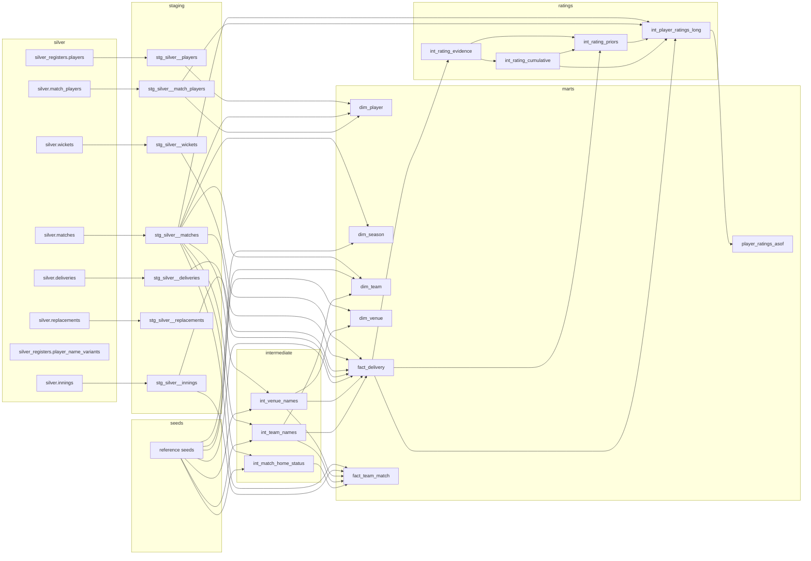

# IPL Squad Value and Auction Picker

Do IPL franchises overpay for big names at auction, and who is undervalued? This repo answers that with a production-style data platform: it ingests every IPL and T20 international ball from [Cricsheet](https://cricsheet.org) into a layered, tested warehouse and builds point-in-time player ratings. Coming next: a calibrated win model, player valuations, and an auction squad optimiser.

The ML is the use case. The product is the platform underneath it: immutable raw data, data contracts, orchestration, lineage, point-in-time correctness and reproducible builds.

## Status

| Phase | What | State |
|---|---|---|
| 1 | Ingestion, raw and staging layers, data quality, orchestration | Done |
| 2 | dbt star schema and point-in-time player ratings | Built; tuning the rating parameters |
| 3 | Squad features and win probability model | Next |
| 4 | Player value, swap simulator and API | Planned |
| 5 | Auction data, price model, optimiser and backtest | Planned |
| 6 | Write-up and polish | Planned |

## Architecture

```
  Cricsheet zips ──► RAW (bronze)      immutable zips + manifest (SHA-256, fetched_at, first_seen_at)
                          │
                          ▼
                     SILVER            parsed, typed Parquet partitioned by season
                          │            pandera contracts · quarantine · reconciliation
                          ▼
                     GOLD (dbt)        star schema + point-in-time ratings in warehouse.duckdb
                          │            contracts enforced · tests on every build
                          ▼
                     win model · player value · price model · optimiser   (Phases 3–5)
```

- **Raw:** a zip is stored only when its SHA-256 is new. A conditional request makes an unchanged source cost one `304`. Only new or corrected match files are parsed.
- **Silver:** Python parses the Cricsheet JSON with pandas and writes season-partitioned Parquet with pyarrow. Rows that break a data contract are quarantined, not dropped silently. Ball-by-ball runs are reconciled against the targets and winning margins Cricsheet records.
- **Gold:** dbt-duckdb reads silver in place. The reference CSVs in [`config/reference/`](config/reference/) are the dbt seeds, so Python and dbt read one copy of every reference fact.
- **Orchestration:** Dagster assets, partitioned by season, cover raw, silver, the quality report and the Elo baseline. The dbt build runs with `make dbt` until it moves into Dagster through `dagster-dbt`.

### dbt lineage

<!-- lineage:start (generated by `make lineage`; do not edit) -->

<!-- lineage:end -->

## Point-in-time ratings

[`player_ratings_asof`](dbt/models/marts/player_ratings_asof.sql) has one row per player per match date, with batting and bowling ratings for each phase of the innings (powerplay, middle and death overs).

- **Point in time:** every rating uses only matches *before* its date. A rating that saw its own match would leak the result into the win model.
- **Time decay:** older balls count for less. Running sums scaled by `e^(λ·day)` and a DuckDB `ASOF JOIN` decay a player's whole history in one join.
- **Shrinkage:** small samples are pulled toward the player's role average (empirical Bayes), so a debutant's 18 off 6 balls doesn't top the list. Roles and priors are point in time too.
- **The test that proves it** ([`test_ratings.py`](tests/warehouse/test_ratings.py)) builds the warehouse, then rebuilds it with every ball from a cutoff date onwards changed. Every rating up to the cutoff must come out identical.

## Results so far

Every number lives in a generated report. None are typed by hand.

- [Data quality report](reports/data_quality.md): matches loaded, quarantined and flagged, per season.
- [Reference audit](reports/reference_audit.md): sourced home grounds checked against where teams actually played.
- [Elo baseline](reports/elo_baseline.md): a negative result. Tuned team Elo doesn't beat a coin flip on 2015–2024, so team identity alone carries little signal and the win model has to be built from players.
- [Exploration notebook](notebooks/01_exploration.ipynb): the toss, chasing, venues and home advantage, with Wilson intervals. All logic is in tested functions in [`cricket_value/analysis/`](cricket_value/analysis/).

## Running it

Requires Python 3.12 and [uv](https://docs.astral.sh/uv/).

```bash
make install     # uv sync
make ingest      # download Cricsheet into data/raw (incremental)
make silver      # parse raw into season-partitioned Parquet
make dbt         # build data/warehouse.duckdb: seeds, models, contracts and tests
make dbt-docs    # dbt docs with the lineage graph at http://localhost:8080
make dagster     # Dagster UI at http://localhost:3000
make rebuild     # delete everything derived, rebuild from raw, check it is identical
make check       # ruff, mypy and pytest
```

The tests build silver and the whole dbt warehouse from 15 fixture matches, so `make check` needs no downloaded data.

## Design notes

- [`DECISIONS.md`](DECISIONS.md) records every design decision, with what the data showed. Where it disagrees with the brief, it wins.
- [`interview_prep.md`](interview_prep.md) explains the reasoning behind each choice and the concepts behind it.
- [`Project_brief.md`](Project_brief.md) is the original scope and ground rules.

## Data

Ball-by-ball data comes from [Cricsheet](https://cricsheet.org), made available under the Open Data Commons Attribution License. T20Is are limited to men's matches between Full Members (as of the match date). Cricsheet withholds men's matches involving Afghanistan, so Afghan players' ratings rest on IPL data only.
